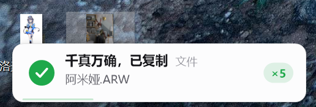

Let's Ctrl+CCCCCCCCCCCCCCCCCCCCCCCCCCCCCCCCCCCCCCC

## 提醒位置 / Notification position

右键托盘图标（macOS 为菜单栏图标），打开 **提醒位置 → 左 / 居中 / 右**，
即可把提醒显示在当前显示器工作区的左下角、底部居中或右下角。默认是左侧。
选择后立即显示剪贴板预览，配置会自动保存，重启后仍然生效。

Right-click the tray icon (menu bar icon on macOS) and choose
**Notification position → Left / Center / Right** to align notifications along
the bottom of the active display's work area. Left is the default. Choosing a
position shows a clipboard preview immediately and saves the preference across restarts.

## 外观与显示 / Appearance and display

右键托盘图标即可配置以下选项，选择后立即预览并自动保存：

| 配置 | 选项 |
| --- | --- |
| 外观模式 | 跟随系统（默认）、浅色、深色 |
| 显示时长 | 默认、1、2、3、5、10 秒 |
| 透明度 | 0%（默认，不透明）、10%、25%、50%、75% |
| 简易模式 | 默认关闭；开启后使用 220×48 DIP 单行卡片，仅显示状态图标和标题，隐藏内容预览、缩略图、元信息及计数徽章 |

默认时长保持原有行为：复制/剪切/失败提醒为 1.9 秒，信息/空剪贴板提醒为 2.6 秒。
手动选择时长后适用于所有提醒。鼠标悬停仍会延长停留，点击可立即关闭。
透明度越高，卡片越透明；它同时作用于卡片背景、文字、图标和阴影。

Right-click the tray or menu bar icon to choose **Appearance** (Follow system / Light / Dark),
**Display duration** (Default / 1 / 2 / 3 / 5 / 10 seconds), **Transparency**
(0% / 10% / 25% / 50% / 75%), or toggle **Simple mode**. Changes preview immediately
and persist across restarts. Simple mode uses a compact 220×48 DIP card with only
the status icon and title. The default duration is 1.9 seconds for copy/cut/failure
and 2.6 seconds for information/empty-clipboard notices. A selected duration applies
to all notices; hovering still extends their lifetime. Transparency affects the
entire card, including text and icons.

Windows 构建：`./build.ps1`。显示配置回归检查及渲染样图：`./test.ps1`
（使用独立注册表测试路径，不修改当前用户的 CCCC 配置）。
